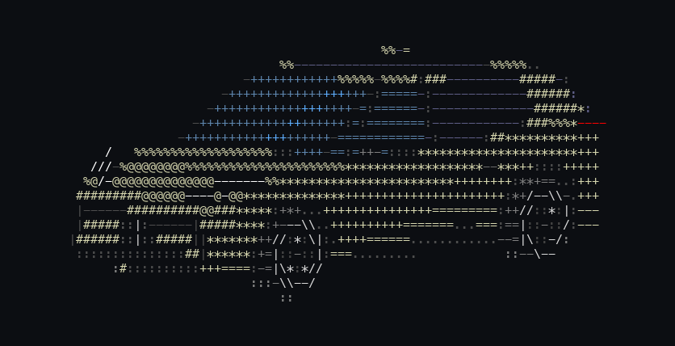

# Zeekr X terminal dashboard

The dashboard shows a live garage view, battery and charging status, and trip history with route replay. The API worker uses your Zeekr owner account because trip history can be unavailable to shared accounts.



## Install

From the project directory on macOS or Linux, use Python 3.10+ with `curses`. Use Python 3.12+ if you also want the optional session capture helper.

```sh
python3 -m venv .venv
.venv/bin/python -m pip install .
.venv/bin/zeekr-x --help
```

The install includes the dashboard, API client, and session helper. From an activated environment, run `zeekr-x` from any directory.

## Configure your account

The default configuration directory is `${XDG_CONFIG_HOME:-$HOME/.config}/zeekr-x`. Set `ZEEKR_CONFIG_DIR` to use a different directory. The dashboard and session capture helper use the same location.

Create the private configuration directory and seed it with the example file.

```sh
zeekr_config="${ZEEKR_CONFIG_DIR:-${XDG_CONFIG_HOME:-$HOME/.config}/zeekr-x}"
mkdir -p "$zeekr_config"
chmod 700 "$zeekr_config"
test -e "$zeekr_config/.env" || install -m 600 .env.example "$zeekr_config/.env"
```

Fill in the private `.env` with your owner account, country code, and the six app-specific API values. Optionally set `ZEEKR_VIN` when there is more than one vehicle on the account. Use plain `KEY=value` lines. An environment variable takes precedence over the matching value in `.env`.

If you already have a saved owner session, place it at `$zeekr_config/session-main.json` with permissions `600`. Keep both private files outside the project and transfer them privately when setting up another machine. The session file can contain a password and active tokens. Git tracks only the blank `.env.example` template. The CLI reads its credentials locally, so a GitHub repository needs no secrets configured to host the code.

## Run

```sh
.venv/bin/zeekr-x
```

| Key | Action |
| --- | --- |
| `G`, `C`, `T` | Switch between Garage, Charging and Trips. |
| `[` / `]` | Browse older or newer trips. |
| `R` | Refresh the current view. |
| `S` | Retry a saved session and attempt password login if needed. |
| `Q` | Quit. |

The dashboard tries the saved session on startup. An owner-account sign-in on another device can invalidate the active session. If the server returns `9300` when you press `S`, supply a valid owner session before trying again.

### Optional session capture

If you already use mitmproxy with your Zeekr app on your own phone or emulator, the included helper can save an owner session from a successful vehicle request. Install the optional dependency into a Python 3.12+ project environment and start the proxy from the project directory.

```sh
.venv/bin/python -m pip install '.[capture]'
.venv/bin/mitmdump -q --listen-port 8080 -s capture_token.py
```

With your app connected to your proxy, sign in to the owner account and refresh the vehicle view. Once the helper reports that it saved `session-main.json`, stop the proxy, restore the device's network settings and restart the dashboard.

## Credits

The bundled API client is based on `zeekr_ev_api` 0.1.15, with a local patch that preserves the device ID in saved sessions. [Upstream revision](https://github.com/Fryyyyy/zeekr_ev_api/tree/4dc9e1789e577864003f9e27b293ade8d47e1e70) · [MIT license](zeekr_x_api/LICENSE)

Street maps use OpenFreeMap and OpenMapTiles with data from OpenStreetMap contributors. [OpenStreetMap attribution](https://www.openstreetmap.org/copyright)
